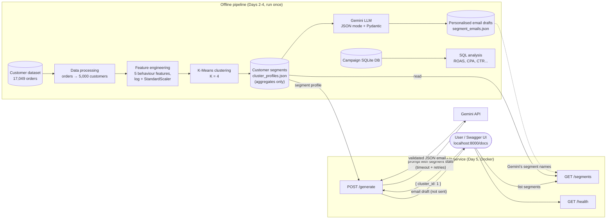

# Campaign Segmenter

Split e-commerce customers into behaviour-based segments with K-Means, then let an LLM (Gemini) write a
personalised marketing email draft for each segment, all served through a small FastAPI service that runs
with one Docker command.

> Project 1 of an AI Engineer sprint: Python, SQL, scikit-learn, LLM APIs, FastAPI and Docker.

## 1. Overview

**The business problem.** Sending the same email to every customer wastes the message. Someone who orders a
$2,000 laptop twice a year and someone who buys discounted books every month need different messages.
Marketers know this, but writing a well-grounded email for every group by hand is slow, and the groups are
often guessed rather than found in the data.

**What Campaign Segmenter does:**

1. **Analyses campaign performance in SQL.** It computes spend, CTR, CVR, CPA and ROAS per channel and per
   campaign on 120 real-shaped campaigns, so you can see where the marketing budget works.
2. **Finds customer segments with K-Means.** It turns 17,049 orders into one profile per customer
   (5,000 customers) and clusters them on purchasing behaviour. The result is **4 segments**.
3. **Writes an email draft per segment with Gemini.** Only *aggregated* segment statistics go to the LLM,
   never individual customers. The reply is forced into a Pydantic schema, checked for invented offers,
   and retried on failure.
4. **Serves it all over HTTP.** `GET /segments` returns the segments and `POST /generate` writes a fresh
   email draft. Interactive docs are at `/docs`. **No email is ever sent**; everything is a draft.

## 2. Features

| | |
|---|---|
| **Customer data processing** | Order-level CSV → one row per customer (frequency, recency, order value, basket size, discount rate) |
| **SQL campaign analysis** | 14 commented queries (joins, CTEs, window functions) over a SQLite database, checked by 21 tests |
| **K-Means segmentation** | K chosen from elbow, silhouette and seed stability. Segments profiled with category *lift* |
| **AI email generation** | Gemini in JSON mode + Pydantic validation, offer/claim guardrails, retries with backoff, timeouts, token and cost logging |
| **FastAPI service** | `GET /segments`, `POST /generate`, `GET /health`, request and response validation, clear error codes, Swagger UI |
| **Docker** | Lean image (264 MB, non-root, no secrets inside), started with `docker compose up --build` |
| **Tests** | 98 automated tests. Gemini is always mocked, so no key, network or cost is needed |

## 3. Technology stack

| Area | Tools |
|---|---|
| Language | Python 3.12 (3.11+ supported) |
| Data | Pandas, NumPy, SQLite, SQL |
| Machine learning | scikit-learn (StandardScaler, **K-Means**, silhouette score, adjusted Rand index) |
| LLM | Google **Gemini API** (`google-genai` SDK, model `gemini-3.8-flash`) |
| Validation | **Pydantic** v2 |
| API | **FastAPI** + Uvicorn (OpenAPI / Swagger UI) |
| Packaging | **Docker**, Docker Compose |
| Testing | pytest, FastAPI TestClient |

## 4. Architecture



**How a request flows.** `POST /generate {"cluster_id": 1}`:

1. FastAPI validates the body (`GenerateRequest`: a non-negative integer, nothing else). A bad body gets `422`.
2. The segment profile for cluster 1 is loaded from `cluster_profiles.json`. An unknown id gets `404`.
3. Day 4's `generate_segment_email()` builds the prompt (segment stats + all-customer baseline) and calls Gemini
   with a 90 s timeout. It retries timeouts, 429s, 5xx and invalid replies with exponential backoff.
4. The reply is parsed, validated by Pydantic and checked for invented offers or leaked numbers. If it still
   fails after all retries, the API answers `502`, or `504` for timeouts.
5. Tokens and the estimated cost are logged to `reports/llm_usage.csv` and returned together with the email.

The API never re-trains the model. It serves the saved K-Means output, which is the usual pattern: train
offline, serve the results online.

```
├── src/
│   ├── api/            main.py (FastAPI app) · schemas.py (API models) · segments.py (load saved results)
│   ├── llm/            generator.py (Gemini) · schemas.py · retry.py · usage_tracker.py
│   └── data/           segment_profiles.py (Day 3 output → aggregated profiles)
├── data/processed/     cluster_profiles.json · segment_emails.json   (committed model outputs)
├── config/             llm_pricing.json · segment_names.json
├── notebooks/          day3_customer_segmentation.ipynb
├── sql/ scripts/ reports/
├── tests/              test_api.py · test_segment_emails.py · test_sql.py
├── headlines.py        Day 1 ad headline generator
├── Dockerfile · compose.yaml · .dockerignore
└── requirements.txt (API runtime) · requirements-dev.txt (everything)
```

## 5. Installation and running

### Quick start: one command (Docker)

Prerequisites: [Git](https://git-scm.com/), [Docker Desktop](https://www.docker.com/products/docker-desktop/)
(running), and a Gemini API key from <https://aistudio.google.com/apikey>.

```bash
git clone https://github.com/samaya8/Campaign-Segmenter.git
cd Campaign-Segmenter
cp .env.example .env          # then edit .env and paste your key: GEMINI_API_KEY=...
docker compose up --build     # ← the one command
```

Open **<http://localhost:8000/docs>** (Swagger UI). Click an endpoint, then **Try it out**, then **Execute**.
Stop with `Ctrl+C`, or with `docker compose down` if you started it with `-d`.

- No key? The app still starts. `/segments` and `/health` work, and `/generate` returns `503` until a key is set.
- Windows PowerShell: use `copy .env.example .env` instead of `cp`.

### How the API key stays secret

- `.env` is listed in `.gitignore` (never committed) and `.dockerignore` (never sent to the Docker build).
- The Dockerfile copies only named files, so the image contains no `.env` and no key. You can check with
  `docker run --rm --entrypoint env campaign-segmenter`.
- The key is injected at **runtime** as an environment variable. `compose.yaml` reads `.env` via `env_file`.
  Without Compose:

  ```bash
  docker build -t campaign-segmenter .
  docker run --rm -p 8000:8000 --env-file .env campaign-segmenter
  # or: docker run --rm -p 8000:8000 -e GEMINI_API_KEY="$GEMINI_API_KEY" campaign-segmenter
  ```
- `/health` reports only *whether* a key is configured, never its value.

| Variable | Required | Default | Purpose |
|---|---|---|---|
| `GEMINI_API_KEY` | for `/generate` | none | Gemini API key |
| `GEMINI_MODEL` | no | `gemini-3.8-flash` | Model used for emails |
| `GEMINI_TIMEOUT_S` | no | `90` | Timeout per Gemini request (seconds) |
| `GEMINI_MAX_ATTEMPTS` | no | `4` | Attempts per email including the first (backoff 2 s → 4 s → 8 s) |

### Without Docker (local Python)

```bash
python -m venv .venv
.venv\Scripts\activate             # Windows   (macOS/Linux: source .venv/bin/activate)
pip install -r requirements-dev.txt   # API + notebooks + SQL + tests  (API only: requirements.txt)
cp .env.example .env               # paste your key
uvicorn src.api.main:app --reload  # → http://localhost:8000/docs
python -m pytest -v                # run the tests (no API key needed)
```

### Data and model artifacts

A fresh clone **already contains everything the API needs**:

| File | Committed? | Produced by | Needed by |
|---|---|---|---|
| `data/processed/cluster_profiles.json` | ✅ | Day 3 notebook → `scripts/generate_segment_emails.py` | API (required) |
| `data/processed/segment_emails.json` | ✅ | `scripts/generate_segment_emails.py` (Gemini) | API (optional: Gemini segment names) |
| `config/segment_names.json` | ✅ | Names from the Day 3 analysis | API (optional) |
| `ecommerce_customer_behavior_dataset_v2.csv` | ❌ (raw data, 2 MB) | E-commerce customer behaviour dataset (download link not recorded in this repo) | Re-running Day 3 only |
| `data/processed/customer_segments.csv` | ❌ (one row per customer) | Day 3 notebook | Re-running Day 4 only |
| `data/raw/marketing_campaigns.sqlite` | ❌ (14.6 MB, needs an account) | [Analytics Engineering](https://www.analyticsengineering.com/datasets/marketing-campaigns) | Day 2 SQL only |

The aggregated JSON files contain only group-level statistics: no customer IDs, names, ages, genders or
cities. Per-customer files stay local.

To **rebuild the segments from scratch**, put the raw CSV in the project root and run:

```bash
jupyter nbconvert --to notebook --execute --inplace notebooks/day3_customer_segmentation.ipynb  # → customer_segments.csv
python scripts/generate_segment_emails.py --dry-run   # → cluster_profiles.json (free, no API call)
python scripts/generate_segment_emails.py             # → segment_emails.json (calls Gemini, ≈ $0.04)
```

If a re-run changes the cluster sizes, the API notices that `config/segment_names.json` no longer matches and
falls back to generic names (`Cluster 2`) instead of showing wrong ones.

## 6. API reference

Base URL `http://localhost:8000`. Interactive docs are at `/docs` (Swagger UI) and `/redoc`. The raw schema is at `/openapi.json`.

### `GET /health`

Liveness check. Always `200` while the app runs.

```json
{"status":"ok","version":"1.0.0","segments_available":true,"gemini_api_key_configured":true,"model":"gemini-3.8-flash"}
```

### `GET /segments`

The 4 K-Means segments with size, share, average behaviour and category preferences. A category counts as a
preference only if its **lift** (segment share ÷ overall share) is above **1.15**. `top_category` is `null` for
segments that buy a broad mix.

```bash
curl http://localhost:8000/segments
```

Real response (cluster 1 shown; 4 segments are returned):

```json
{
  "total_customers": 5000,
  "total_orders": 17049,
  "n_clusters": 4,
  "data_end_date": "2024-03-25",
  "preference_lift_threshold": 1.15,
  "segments": [
    {
      "cluster_id": 1,
      "segment_name": "Big-Basket Buyers",
      "description": "Infrequent but the largest orders; lean towards Electronics and Home & Garden; almost no discounts.",
      "ai_segment_name": "High-Value Electronics and Home Shoppers",
      "customer_count": 1433,
      "percentage": 28.7,
      "characteristics": {
        "avg_total_spend": 4755.66, "median_total_spend": 3178.34, "avg_order_value": 2063.4,
        "avg_orders_per_customer": 2.36, "pct_single_order_customers": 22.9, "avg_items_per_order": 3.73,
        "avg_recency_days": 154.9, "pct_ordered_in_last_90_days": 35.2, "avg_discount_rate_pct": 1.74,
        "pct_customers_who_used_a_discount": 48.2, "avg_rating": 3.91
      },
      "top_category": "Electronics",
      "preferred_categories": [
        {"category": "Electronics", "share_of_orders_pct": 16.5, "lift_vs_all_customers": 1.35},
        {"category": "Home & Garden", "share_of_orders_pct": 14.2, "lift_vs_all_customers": 1.17}
      ]
    }
  ]
}
```

| Status | When |
|---|---|
| 200 | Segments returned |
| 503 | `cluster_profiles.json` missing or invalid |

### `POST /generate`

Writes a new email draft for one segment with Gemini. A call usually takes 15–70 s. **Nothing is sent.**

```bash
curl -X POST http://localhost:8000/generate -H "Content-Type: application/json" -d '{"cluster_id": 1}'
```

Real response (2026-11-21, `gemini-3.8-flash`):

```json
{
  "cluster_id": 1,
  "segment_name": "High-Value Tech and Home Shoppers",
  "customers": 1433,
  "pct_of_all_customers": 28.7,
  "typical_customer_description": "A typical customer in this segment makes substantial, infrequent purchases with high average basket values. ...",
  "purchasing_behavior": "Customers in this segment average 2.36 orders with a high average order value of $2,063.40 and 3.73 items per order. ...",
  "product_interests": ["Electronics", "Home & Garden"],
  "marketing_strategy": "Re-engage these lapsed, high-value shoppers by highlighting quality across their preferred Electronics and Home & Garden categories. ...",
  "email": {
    "subject": "Enhance your everyday space and setup",
    "greeting": "Hello {{first_name}},",
    "body": "Whether you are planning your next home project or looking to upgrade your personal tech, having the right setup makes all the difference.\n\nFrom functional additions for your living spaces to versatile technology, our catalog offers quality options designed to fit seamlessly into your day. Whenever you are ready to explore, we invite you to browse our Electronics and Home & Garden categories to find what suits your routine.\n\nTake your time discovering items that bring lasting comfort and utility to your everyday environment.\n\nWarm regards,\nThe {{store_name}} team",
    "call_to_action": "Browse Electronics & Home"
  },
  "marketing_angle": "Highlighting thoughtful lifestyle upgrades in Electronics and Home & Garden without discount promotions.",
  "personalization_reason": "Cluster 1 has a substantially higher average order value ($2,063.40 vs $1,262.89 baseline) and low discount usage (1.74% vs 5.16%), alongside clear category affinity for Electronics (1.35 lift) and Home & Garden (1.17 lift). ...",
  "status": "draft - not sent",
  "generation": {
    "model": "gemini-3.8-flash", "attempts": 1,
    "input_tokens": 1670, "output_tokens": 7078, "total_tokens": 8748,
    "estimated_cost_usd": 0.027795
  }
}
```

| Status | When | Example `detail` |
|---|---|---|
| 200 | Email generated and validated | |
| 404 | Unknown `cluster_id` | `cluster_id 7 does not exist. Available cluster_ids: [0, 1, 2, 3].` |
| 422 | Invalid body: missing, negative, `"0"` (string), `1.5`, `true`, extra fields | FastAPI validation details |
| 502 | Gemini failed, rejected the key, or no reply passed validation after all retries | `Gemini replied, but no reply passed validation after 4 attempt(s): ...` |
| 503 | `GEMINI_API_KEY` not set, Gemini rate limit, or segment data missing | `GEMINI_API_KEY is not configured on the server. ...` |
| 504 | Gemini timed out on every attempt | `Gemini timed out on all 4 attempt(s). ...` |

## 7. Results

All numbers below come from this repo's code and saved outputs.

### Customer segmentation (Day 3)

- **Data:** 17,049 orders from **5,000 customers** (Jan 2023 – Mar 2024). No missing values, duplicates or
  invalid numbers, so no rows were removed.
- **Features (5):** `frequency`, `recency_days`, `avg_order_value` (log-transformed, skewness ≈ 4),
  `avg_quantity`, `discount_rate`, all standardised. Rating, session time, pages viewed and delivery time were
  tested and dropped, because adding them lowers the silhouette at every K.
- **Model:** `KMeans(random_state=42, n_init=10)` for K = 2–8.

| K | 2 | 3 | **4** | 5 | 6 | 7 | 8 |
|---|---:|---:|---:|---:|---:|---:|---:|
| Inertia | 19,883 | 16,658 | **14,238** | 12,674 | 11,609 | 10,867 | 10,213 |
| Silhouette | 0.2039 | 0.1932 | **0.2117** | 0.2104 | 0.2043 | 0.2026 | 0.1973 |

**Selected K = 4.** It has the highest silhouette score (0.2117), sits at the elbow of the inertia curve, and
is the most stable across random seeds (adjusted Rand index **0.998**). It also gives four groups that call for
different marketing actions.

| Cluster | Segment | Customers | Avg total spend | Avg order value | Orders | Recency (days) | Discount | Prefers (lift > 1.15) |
|---:|---|---:|---:|---:|---:|---:|---:|---|
| 0 | Low-Value Occasional Buyers | 1,255 (25.1%) | 929.71 | 427.13 | 2.16 | 165.9 | 2.8% | Books 1.32, Beauty 1.21, Food 1.21 |
| 1 | Big-Basket Buyers | 1,433 (28.7%) | 4,755.66 | 2,063.40 | 2.36 | 154.9 | 1.7% | Electronics 1.35, Home & Garden 1.17 |
| 2 | Discount-Driven Shoppers | 1,024 (20.5%) | 3,034.16 | 1,121.57 | 2.70 | 129.1 | 13.8% | broad mix |
| 3 | Loyal Frequent Buyers | 1,288 (25.8%) | 8,300.02 | 1,298.94 | 6.36 | 51.4 | 4.5% | broad mix |
| | *All customers* | *5,000* | | *1,262.89* | | *125.7* | *5.2%* | |

A silhouette of about 0.21 means the groups overlap, so treat the boundaries as soft. Notebook:
[`notebooks/day3_customer_segmentation.ipynb`](notebooks/day3_customer_segmentation.ipynb).

### Generated emails (Day 4 batch run, 2026-11-13, `gemini-3.8-flash`)

**4/4 segments succeeded with 0 retries.** All drafts are in
[`data/processed/segment_emails.json`](data/processed/segment_emails.json).

| Cluster | Segment (named by Gemini) | Subject line | CTA |
|---:|---|---|---|
| 0 | Lapsing Everyday Essentials Buyers | A quiet moment for your favourite reads and essentials | Explore Books and Beauty |
| 1 | High-Value Electronics and Home Shoppers | Upgrade your living space and technology | Explore Electronics and Home |
| 2 | Value-Conscious Broad Shoppers | Smart choices and lasting value for you | Explore the Store |
| 3 | Frequent High-Value Repeat Shoppers | A warm thank you for continuing to shop with us | Explore Our Full Store |

Example (cluster 0), as saved:

> **Subject:** A quiet moment for your favourite reads and essentials
>
> Hello {{first_name}},
>
> It has been a little while since your last visit, and we would love to welcome you back. Whether you are
> looking to unwind with a good read, replenish your daily self-care essentials, or find tasty pantry staples,
> our shelves are ready whenever you are. [...] The {{store_name}} team
>
> **CTA:** Explore Books and Beauty

### Token usage and estimated cost

From `reports/llm_usage.csv` (written on each run; kept local, not committed). Costs are **estimates** at $0.75 per 1M input and $3.75 per 1M output tokens
(`config/llm_pricing.json`). Thinking tokens are billed as output.

| Run | Calls | Input tokens | Output tokens (of which thinking) | Est. cost |
|---|---:|---:|---:|---:|
| Day 4 batch, 4 segments (2026-11-13, final run) | 4 | 6,678 | 9,201 (6,939) | $0.0395 |
| Day 5 `POST /generate`, cluster 1 (2026-11-21) | 1 | 1,670 | 7,078 (6,585) | $0.0278 |

Output length, and therefore cost, varies a lot between calls (1.1k–7.1k output tokens) because the model's
thinking length varies. Expect roughly **$0.005–0.03 per email**.

### Campaign performance (Day 2, SQL)

| Channel | Spend | Revenue | CTR | CPC | CVR | CPA | ROAS |
|---|---:|---:|---:|---:|---:|---:|---:|
| affiliate | $857.8k | $5.61M | 2.50% | $0.36 | 0.43% | $82.87 | **6.54** |
| paid_search | $897.1k | $5.44M | 3.49% | $0.52 | 0.58% | $89.54 | 6.06 |
| paid_social | $984.7k | $4.69M | 1.79% | $0.61 | 0.54% | $113.87 | 4.76 |
| display | $955.3k | $3.73M | 0.60% | $1.09 | 0.77% | $141.65 | 3.91 |
| video | $828.1k | $2.09M | 0.89% | $1.68 | 0.80% | $210.55 | **2.52** |
| **total** | **$4.52M** | **$21.56M** | 1.63% | $0.64 | 0.56% | $113.94 | **4.77** |

- **Affiliate** earns the most revenue and has the best ROAS. **Paid search** has the highest CTR.
- **Video** takes 18.3% of spend for 9.7% of revenue. All 24 video campaigns are below the 4.77 average.
- Big spend ≠ big revenue: only 2 of the 10 biggest spenders are top 10 in revenue.

Full report with every query and its output: [`reports/sql_results.md`](reports/sql_results.md).

### Tests

`python -m pytest -v` runs **98 tests: 34 API + 43 Day 1/4 + 21 SQL**. Gemini is always mocked. The SQL tests are
skipped automatically when the SQLite database hasn't been downloaded (for example in a fresh clone).

## 8. Limitations and future improvements

**Limitations**

- **Soft clusters.** A silhouette of about 0.21 means segments overlap; customers near a boundary could reasonably
  belong to either group. The data is a single dataset covering Jan 2023 – Mar 2024, and segments will drift
  over time.
- **Static model.** The API serves saved results. New customers are not assigned to a segment, and there is no
  `/predict` endpoint, because the fitted scaler and K-Means model are not saved.
- **LLM analysis fields are not fact-checked.** The guardrails check the *customer-facing* email (no invented
  offers, prices or percentages) and the JSON schema. The analysis text can still be imprecise. In the Day 5
  run above, Gemini described a recency of 154.9 days (baseline 125.7, so *less* recent) as "lower than average".
- **Slow, synchronous generation.** One `/generate` call takes 15–70 s (mostly model thinking time) and holds a
  worker thread. There is no caching, so every call costs tokens.
- **No authentication or rate limiting.** Anyone who can reach port 8000 can spend your Gemini quota. Keep the
  service local or put it behind auth.
- **Usage log is per container.** Inside Docker, `reports/llm_usage.csv` is lost when the container is removed.
- **Raw dataset provenance.** The e-commerce dataset's download link is not recorded in the repo yet.

**Next steps**

- Save the fitted `StandardScaler` + `KMeans` (joblib) and add `POST /predict` to segment new customers.
- Cache generated drafts per (cluster, model) and add a `?fresh=true` option. Or run generation as a background job.
- Add an LLM-as-judge or numeric check that every number in the analysis fields matches the profile.
- Add an API key header and rate limits. Mount a volume for the usage log.
- Try other segmentation methods (Gaussian mixtures, RFM scoring) and A/B test the email drafts.
- CI: run the tests and `docker build` on every push.

---

<details>
<summary><b>Pipeline details: how each day's component works</b></summary>

### Day 1: ad headline generator

```bash
python headlines.py "Noise-cancelling wireless earbuds with 30-hour battery life"
```

Gemini is called with `response_mime_type="application/json"` and a Pydantic `response_schema`. The raw text is
re-validated with `HeadlineSet.model_validate_json` (exactly 3 headlines, each ≤ 90 chars) and retried up to 3 times.

### Day 2: SQL on campaign data

Download the **SQLite database** from <https://www.analyticsengineering.com/datasets/marketing-campaigns>
(free account) and save it as `data/raw/marketing_campaigns.sqlite`. Dataset: *Marketing Campaigns & Conversions*
v1.0.0, Analytics Engineering (2026), CC BY 4.0. Scripts open it read-only.

```bash
python scripts/inspect_db.py              # tables, columns, row counts, key/relationship checks
python scripts/run_queries.py             # run all 14 queries
python scripts/run_queries.py Q04 Q10     # selected queries
python scripts/run_queries.py --markdown  # regenerate reports/query_outputs.md
```

```
campaigns (120) 1 ──< daily_spend (11,240)   one row per campaign per day
campaigns       1 ──< leads (261,684)        one row per lead
leads           1 ──o conversions (39,696)   at most one conversion per lead
```

Spend and revenue are aggregated to one row per campaign **before** joining. Joining daily rows straight to
conversion rows would repeat each day's spend once per conversion (a test shows a >10× inflation).
Files: [`sql/queries.sql`](sql/queries.sql), [`reports/sql_results.md`](reports/sql_results.md),
[`reports/query_outputs.md`](reports/query_outputs.md), `tests/test_sql.py`.

### Day 3: K-Means

Notebook [`notebooks/day3_customer_segmentation.ipynb`](notebooks/day3_customer_segmentation.ipynb): aggregation to one
row per customer, feature selection, log transform, scaling, K = 2–8, elbow, silhouette, seed stability (ARI),
final model and business interpretation. Writes `data/processed/customer_segments.csv` (local only).

### Day 4: email per segment

```bash
python scripts/generate_segment_emails.py --dry-run     # show exactly what Gemini receives (free)
python scripts/generate_segment_emails.py               # generate all 4 emails
python scripts/generate_segment_emails.py --clusters 2 --timeout 60 --max-attempts 3
```

1. `src/data/segment_profiles.py` aggregates Day 3's output plus order categories into one validated statistics
   block per cluster (size, spend, order value, frequency, recency, discount use, rating, category mix and lift).
2. `src/llm/generator.py` sends one cluster profile plus the all-customer baseline per call (JSON mode, Pydantic
   `response_schema`).
3. The reply is re-validated (`SegmentEmailResponse`, 12 required fields). It is rejected if the email invents an offer
   (percentages, money, coupons, free shipping, "exclusive deal", loyalty points), mentions "segments", or uses
   unknown placeholders. Only `{{first_name}}` and `{{store_name}}` are allowed.
4. `src/llm/retry.py` retries timeouts, 429, 5xx and invalid replies with exponential backoff (2 s → 4 s → 8 s, ±25%
   jitter, cap 30 s, max 4 attempts, honouring Gemini's `retryDelay`). 401/403/404/400 fail immediately. 90 s
   timeout per request. SDK retries are off, so nothing is retried twice.
5. `src/llm/usage_tracker.py` logs tokens from `usage_metadata` and the **estimated** cost to `reports/llm_usage.csv`.
   Missing usage or prices are left empty, never guessed.

### Marketing terms

| Term | Meaning | Formula |
|------|---------|---------|
| **CTR**, click-through rate | Share of people who saw the ad and clicked it | clicks ÷ impressions |
| **CVR**, conversion rate | Share of clicks that turned into a sale | conversions ÷ clicks |
| **CPC**, cost per click | What each click cost | spend ÷ clicks |
| **CPA**, cost per acquisition | What each conversion cost | spend ÷ conversions |
| **ROAS**, return on ad spend | Revenue per unit of spend | revenue ÷ spend |

</details>
